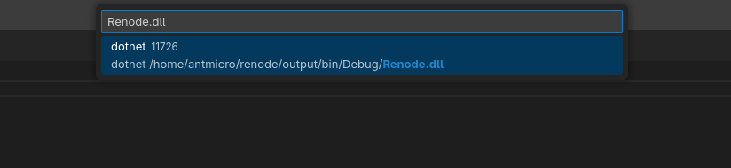

# Developing Renode

Renode has many built-in features to enable debugging of embedded software, e.g. [debugging with GDB](../debugging/gdb.md), but sometimes you might be interested in debugging Renode itself, especially if you are involved in its development

## VS Code configurations

Visual Studio Code's extensive plugin ecosystem provides a good developer experience for working with the Renode codebase.
You may decide to use either the official [VS Code](https://code.visualstudio.com/) app from Microsoft or use one of the OSS binary releases [VSCodium](https://github.com/VSCodium/vscodium) or [code-server](https://github.com/coder/code-server).
The main difference between the official and OSS releases is that they use different extensions gallery, so some extensions may be unavailable for each version.

When launching Renode in VS Code, you can use several ready-to-use configurations (as defined in the [`launch.json` file](https://github.com/renode/renode/blob/master/.vscode/launch.json)):

* `Launch (console)` - launches a previously built Renode under the .NET debugger.
* `Attach` - attaches the .NET debugger to a running Renode instance.
* `(gdb) Tlib Attach` - required to connect to a previously launched instance of Renode via GDB to debug translation libraries (implementation of emulated cores).

The workspace also provides build tasks (as defined in the [`tasks.json` file](https://github.com/renode/renode/blob/master/.vscode/tasks.json)):

* `Build - Debug` - equivalent to running `./build.sh -d` from the console.
* `Build - Release` - equivalent to running `./build.sh` from the console.

These configurations require the following VS Code extensions:

* [ms-dotnettools.csdevkit](https://marketplace.visualstudio.com/items?itemName=ms-dotnettools.csdevkit)
* [ms-vscode.cpptools](https://marketplace.visualstudio.com/items?itemName=ms-vscode.cpptools)

### Debugging C# code

By following the steps below, you will be able to add regular breakpoints in Renode's C# code.

1. Build Renode in debug configuration (or use the `Build - Debug` task in VS Code).

    ```bash
    ./build.sh -d
    ```

1. Use the `Launch (console)` configuration.

1. When Renode starts, you can set breakpoints and debug C# code as usual.

### Debugging C code (translation libraries)

To debug the C implementation of emulated cores, follow the steps below.

1. Build Renode in debug configuration (or use the `Build - Debug` task in VS Code).

    ```bash
    ./build.sh -d
    ```

1. Launch Renode with the debug flag enabled.

    ```bash
    ./renode -d
    ```

1. When Renode starts, load the platform with a CPU whose code you wish to debug.

1. Use the `(gdb) Tlib Attach` configuration to connect with GDB. 

1. Once started, a popup will appear. In the popup, type in `Renode.dll`.

1. From the drop-down list, select the option ending with `Renode.dll`, as highlighted in the screenshot below.

:::{figure-md}


VSCode .NET drop-down list
:::

## Debugging with GDB

To start debugging Renode and its components using [GDB](https://www.sourceware.org/gdb/), follow these steps:

1. Build Renode in debug configuration.

    ```bash
    ./build.sh -d
    ```

1. Launch Renode with the debug flag enabled.

    ```bash
    ./renode -d
    ```

1. Attach GDB to a running Renode process to debug implementation of cores (in C via GDB).

### Useful VS Code extensions

Below, you can find a list of VS Code extensions that may prove useful when working with Renode:

* Description
    * [Open VSX Registry](https://open-vsx.org/)
    * [Visual Studio Marketplace](https://marketplace.visualstudio.com/)
* C# support (code completion and debugging)
    * [muhammad-sammy.csharp](https://open-vsx.org/extension/muhammad-sammy/csharp)
    * [ms-dotnettools.csdevkit](https://marketplace.visualstudio.com/items?itemName=ms-dotnettools.csdevkit)
* C support (code completion and debugging)
    * [llvm-vs-code-extensions.vscode-clangd](https://open-vsx.org/extension/llvm-vs-code-extensions/vscode-clangd) and [vadimcn.vscode-lldb](https://open-vsx.org/extension/vadimcn/vscode-lldb)
    * [ms-vscode.cpptools](https://marketplace.visualstudio.com/items?itemName=ms-vscode.cpptools)
* CMake support (for standalone Tlib building)
    * [ms-vscode.cmake-tools on Open VSX](https://open-vsx.org/extension/ms-vscode/cmake-tools)
    * [ms-vscode.cmake-tools on VS Marketplace](https://marketplace.visualstudio.com/items?itemName=ms-vscode.cmake-tools)
* Python support
    * [ms-python.python on Open VSX](https://open-vsx.org/extension/ms-python/python)
    * [ms-python.python on VS Marketplace](https://marketplace.visualstudio.com/items?itemName=ms-python.python)
* Robot Framework language server
    * [robocorp.robotframework-lsp on Open VSX](https://open-vsx.org/extension/robocorp/robotframework-lsp)
    * [robocorp.robotframework-lsp on VS Marketplace](https://marketplace.visualstudio.com/items?itemName=robocorp.robotframework-lsp)
* Debugging embedded targets with Renode's GDB server
    * [marus25.cortex-debug on Open VSX](https://open-vsx.org/extension/marus25/cortex-debug) and [webfreak.debug on Open VSX](https://open-vsx.org/extension/webfreak/debug)
    * [marus25.cortex-debug on VS Marketplace](https://marketplace.visualstudio.com/items?itemName=marus25.cortex-debug) and [webfreak.debug on VS Marketplace](https://marketplace.visualstudio.com/items?itemName=webfreak.debug)

:::{note}

Some of these extensions may require additional configuration depending on your machine's setup.
[Tlib](https://github.com/antmicro/tlib/blob/master/CMakeLists.txt) should be first built with CMake to generate the `compile_commands.json` file for `clangd` language services.

:::
